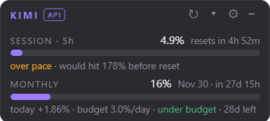
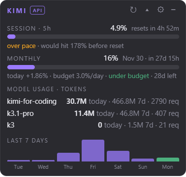
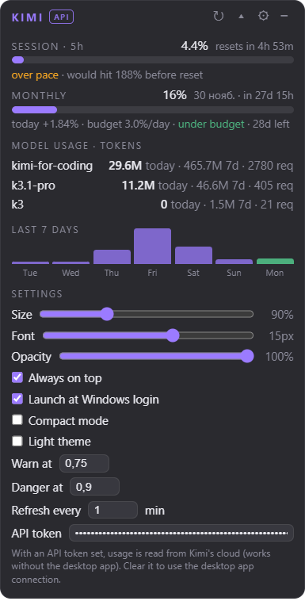
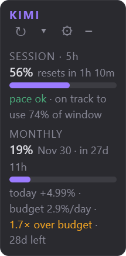

# Kimi Usage Widget

An always-on-top desktop widget for **Kimi Code** quota: the 5-hour session window, the monthly quota, per-model token stats, and daily-equivalent burn estimates. Inspired by [claude-usage-widget](https://github.com/SlavomirDurej/claude-usage-widget), rewritten for Kimi Code with two data sources: the Kimi Code desktop app's local server, or Kimi's cloud usage API with an API key.




## Features

- **SESSION · 5h** — usage %, reset countdown, and a projection: at your current burn rate, what % of the window will you consume by reset (≤85% *pace ok*, ≤100% *tight*, >100% *over pace*).
- **MONTHLY** — usage %, reset date + countdown, and the daily line: `today +1.84% · budget 3.0%/day · under budget · 28d left`. "Today" is measured against the widget's own per-minute quota history at local midnight; the budget spreads the remaining quota evenly over the days left until reset.
- **▾ Model stats** — per-model tokens (today / 7d / request counts) from your Kimi Code session logs, plus a 7-day per-day token chart.
- **⚙ Settings** — size (true UI zoom), font size, opacity, always-on-top, launch at Windows login, compact mode, slim vertical layout, light theme, warn/danger thresholds, refresh interval, and an API token for the cloud source. All persisted.



### Slim vertical layout

A narrow, tower-style variant: the same slim progress bars stacked in a ~170px column, big percentages, and status lines that wrap word by word. The window slims down and goes back to full width whenever you open the model stats or settings.


- System tray: show/hide, refresh now, always-on-top, launch at login, quit. `−` minimizes to tray.
- Self-healing window layout, auto-refresh every minute (configurable), transient network failures handled silently with last-good data.

## Requirements

- Windows 10/11 (the launcher/autostart bits are Windows-specific; the core runs on any Electron platform)
- [Node.js](https://nodejs.org/) 18+
- A data source — either:
  - the **Kimi Code desktop app**, running and logged in, or
  - an **API key** from the [Kimi Code Console](https://www.kimi.com/code/docs/en/) (works without the desktop app)

## Running

```bash
npm install        # see Troubleshooting if the Electron binary stalls
npm start
```

or double-click `Kimi Usage Widget.vbs` (launches hidden, no console window).

**Launch at Windows login**: enable it in the settings panel or tray menu. It creates a shortcut in the Windows startup folder that runs the VBS launcher hidden; disabling removes the shortcut.

## Using an API key (cloud source)

Paste an API key into the **API token** field in the widget's settings (create keys in the Kimi Code Console). The widget then reads quota directly from `GET https://api.kimi.com/coding/v1/usages` — the same endpoint the Kimi Code CLI's `/usage` command calls — and shows an **API** badge in the header. This works even when the desktop app is closed, and it also exposes the 7-day window (legacy plans) and your Extra Usage wallet balance when present. Clear the field to go back to the desktop-app connection. The key is stored only in the widget's local settings file on your machine.

## How it works

| Layer | What |
|---|---|
| Live quota (local source) | `GET /api/v1/oauth/usage` on the Kimi Code desktop app's local server, bearer token from `~/.kimi-code/server.token`; the server address is re-read from the app's instance registry every poll, so app restarts and updates are picked up automatically. |
| Live quota (cloud source) | `GET https://api.kimi.com/coding/v1/usages` (falls back to `api.kimi.ai` on network failure) with your API key; snake_case response normalized to the same internal shape. |
| Model stats | `usage.record` events in `~/.kimi-code/sessions/**/wire.jsonl` aggregated per model, bucketed by local day. |
| Consumed today | Quota ratios sampled every poll into a rolling history; the value at local midnight is linearly interpolated and subtracted from the current ratio. |

In local mode nothing leaves the machine — the widget only talks to `127.0.0.1` and reads local log files. In cloud mode the only outbound call is the authenticated usage endpoint.

## The 5-hour window is fixed, not rolling

Kimi's docs say "rolling 5-hour window", but live API behavior shows a **fixed, chained** window: `resetAt` stays pinned (it crept 1 second over 100 idle seconds in testing), and nothing refills inside a window. The widget therefore *projects* your consumption (`usedRatio ÷ elapsedFraction`) instead of assuming continuous refill.

## Project layout

```
main.js                 Electron main: window, tray, polling, settings, resize engine, autostart
preload.js              contextBridge IPC surface
renderer/               UI (plain HTML/CSS/JS, no framework)
src/quota.js            usage fetchers — local server + cloud API (pure Node, testable)
src/wirestats.js        wire-log aggregation (pure Node)
src/history.js          quota ratio history + midnight baseline (pure Node)
test-data.js            smoke test for the src modules
cdp-verify-settings.js  32-assertion UI/settings verification over the DevTools protocol
cdp-shot.js             DOM dump + screenshots over the DevTools protocol
fetch-electron.sh       parallel-range Electron binary downloader (mirror fallback)
Kimi Usage Widget.vbs   hidden launcher (no console window)
docs/                   design notes, audit report, screenshots
```

## Verifying changes

```bash
node test-data.js                 # data modules against live data
# full UI/settings suite (widget must run with a debug port):
powershell -Command "Start-Process -WindowStyle Hidden -WorkingDirectory . -FilePath 'node_modules\electron\dist\electron.exe' -ArgumentList '.','--remote-debugging-port=9226'"
node cdp-verify-settings.js 9226  # expect: 32 passed, 0 failed
```

## Troubleshooting

- **"Kimi Code desktop app is not running"** (local source) — start the Kimi Code app and log in; the widget picks it up within a poll interval. If the app updated and changed its server registry, update the widget.
- **"API key rejected (401)"** (cloud source) — the key is invalid or expired; create a fresh one in the Kimi Code Console.
- **npm install stalls on the Electron binary** — GitHub's CDN is throttled on some networks. The project pins `electron_mirror` in `.npmrc` (npmmirror); if it still stalls, run `bash fetch-electron.sh` (downloads the binary zip with parallel range requests and unpacks it into `node_modules/electron/dist` exactly where the installer would).

## Disclaimer

Unofficial community tool, not affiliated with or endorsed by Moonshot AI. It reads only the data sources described above and transmits nothing anywhere else.

## License

MIT.
